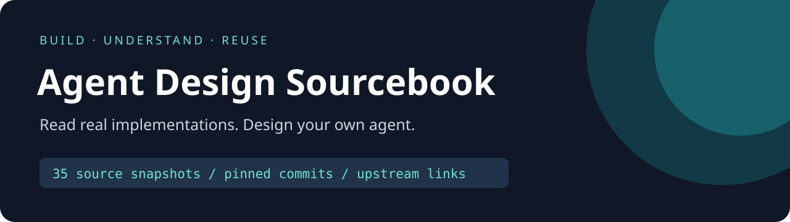

<p align="center"></p>

<p align="center"><strong>Design your agent by studying real implementations.</strong><br/>35 pinned public source snapshots, with original websites, provenance and guided reading paths.</p>

<p align="center"><a href="README.md">中文</a> · <b>English</b> · <a href="SOURCES.md">All 35 sources</a> · <a href="docs/READING_PATHS.md">Reading paths</a> · <a href="https://github.com/Geruyang/agent-skills-library">Skill companion</a></p>

The hard questions often arrive after the first tool call. Where does state live? How does execution recover? Who authorizes a tool? How does the UI show progress? This collection puts relevant implementations on one map so you can compare designs and make decisions for your own application.

## Find an implementation for your question

| Your question | Start with |
|---|---|
| Coding-agent loops, execution and approvals | [Codex](code/openai/codex), [TRAE Agent](code/bytedance/trae-agent), [OpenCode](code/anomalyco/opencode), [Gemini CLI](code/google-gemini/gemini-cli), [Cline](code/cline/cline) |
| Embedding an agent in an application | [OpenAI Agents Python](code/openai/openai-agents-python), [Agents JS](code/openai/openai-agents-js), [Claude Agent SDK](code/anthropics/claude-agent-sdk-python), [OpenHands SDK](code/OpenHands/software-agent-sdk) |
| Self-hosted services, state and execution environments | [Agent Foundation](code/converge-ai-labs/agent-foundation), [Goose](code/aaif-goose/goose), [Pi](code/earendil-works/pi) |
| Chat products, desktop clients and frontend events | [LibreChat](code/LibreChat-AI/LibreChat), [Cherry Studio](code/CherryHQ/cherry-studio), [AG-UI](code/ag-ui-protocol/ag-ui), [ChatKit samples](code/openai/openai-chatkit-advanced-samples) |
| Tool connections, skill formats and context | [MCP SDK](code/modelcontextprotocol/typescript-sdk), [MCP servers](code/modelcontextprotocol/servers), [Agent Skills](code/agentskills/agentskills), [Context Engineering](code/muratcankoylan/Agent-Skills-for-Context-Engineering) |

**[SOURCES.md](SOURCES.md)** lists every upstream repository, official homepage, pinned revision and license summary. Actual source files are included: the ZIP can be browsed locally without opening 35 separate websites.

## Why this collection

- **Navigate by design problem**, across runtimes, SDKs, tools, interfaces and skills.
- **Compare pinned versions**: each snapshot records the upstream commit so observations can be reproduced.
- **Read source directly**: 35 main projects, including the checked-out Cline benchmark submodule and original notices.
- **Share bilingual navigation** with your team.
- **Connect methods with implementations**: the companion [Agent Skills Library](https://github.com/Geruyang/agent-skills-library) includes `agent-designer` for architecture work; this repository supplies reference implementations.

## Download and explore

Use **Code → Download ZIP**, or:

```bash
git clone --depth 1 https://github.com/Geruyang/agent-design-sourcebook.git
cd agent-design-sourcebook
```

On Windows, enable long paths for this clone when needed:

```bash
git -c core.longpaths=true clone --depth 1 https://github.com/Geruyang/agent-design-sourcebook.git
```

The expanded upstream material is approximately 2.36 GB. Every project has its own dependencies, platform requirements and setup instructions. Read its original README; this collection is not one application with a shared launch command.

## A first reading route

1. Read [Agent Foundation](code/converge-ai-labs/agent-foundation/README.md) to distinguish runtime, service and interaction layers.
2. Explore [OpenAI Agents Python](code/openai/openai-agents-python/README.md) for tools and agent execution.
3. Study connection boundaries in the [MCP TypeScript SDK](code/modelcontextprotocol/typescript-sdk/README.md).
4. Compare [AG-UI](code/ag-ui-protocol/ag-ui/README.md) for frontend event delivery.
5. Build one small input → tool → result path in your own project, then add recovery and evaluation.

Choose another route for a [coding assistant, research agent or self-hosted product](docs/READING_PATHS.md).

## Attribution, scope and contributions

Upstream authors retain credit and rights. Every component keeps its own license and notices. Some projects use community or commercial terms; this aggregate does not turn them into one MIT-licensed product. See [NOTICE.md](NOTICE.md).

The public Claude Code repository is not its complete product source. TRAE Agent is not the TRAE desktop client. Third-party ChatGPT clients are not the official OpenAI client. Personal settings, credentials, migration backups and internal plugin bundles are excluded.

Contribute reading routes, version-update proposals and attribution corrections. Discuss product-code changes upstream first so these snapshots stay traceable. **Star this map if it saves you research time, and support the original projects you learn from.**
